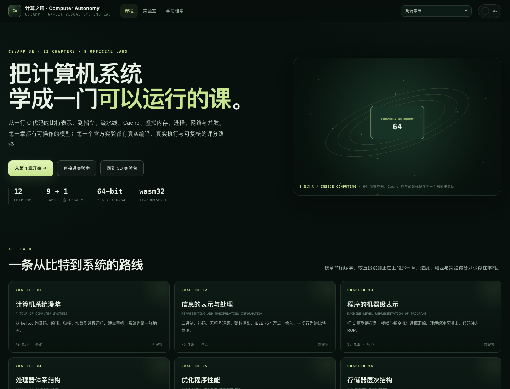

# 计算之境 · Inside Computing

**在 3D 计算机里学 CS:APP。** 一个可本地运行、也适合课堂演示的计算机系统课程平台：12 章原创教学、10 个实验入口、可视化模型、即时检查、学习档案与学习作品集导出。

[](https://github.com/changer-changer/inside-computing/actions/workflows/test.yml)
[](LICENSE)
[](LICENSE-CONTENT.md)
[](COMMERCIAL.md)
[](#快速开始)

> 这是一个教学项目，不是 CS:APP 官方产品，也不分发官方实验答案。官方实验原包与 Linux VM 资产因体积和授权原因不放入本仓库；课程层、实验模型、自动检查与结果导入链接仍可直接运行。
>
> **许可提示**：本仓库公开源代码，但采用**非商业**许可（PolyForm Noncommercial / CC BY-NC-SA 4.0），不是 OSI 定义的开源软件；公司或收费服务需要另行取得商业许可，见 [COMMERCIAL.md](COMMERCIAL.md)。



## 这是什么

CS:APP 的知识通常是“书 + 实验 + 工具链”三件套，但三者容易脱节。本项目把它们接在一条路径上：

- **看得见**：用 3D 场景、栈/缓存/页表/流水线模型解释抽象概念。
- **做得出**：每个实验有浏览器工作台、样例、检查器或官方实验机工作流。
- **评得清**：浏览器检查给出确定分；官方 `driver.pl` / `test-csim` / `mdriver` / proxy driver 的结果可以回填到学习档案。
- **带得走**：进度和代码只存本机，可导出进度 JSON 与 Markdown 学习作品集。

适合：CS:APP 自学者、操作系统/体系结构课程的学生、需要课堂演示的教师，以及想给课程做交互式作业的开发者。

## 内容一览

| 模块 | 内容 |
|---|---|
| 第 1–12 章 | 系统漫游、数据表示、x86-64、Y86-64/流水线、性能、Cache、链接、异常控制流、虚拟内存、I/O、网络、并发 |
| 实验 | Data、Bomb、Attack、Architecture、Cache、Performance、Shell、Malloc、Proxy；Buffer 作为 legacy 对照 |
| 3D 实验台 | 取指/执行、Cache、流水线、栈帧、VM、x86-64 汇编、终端等交互场景 |
| 教学闭环 | 章节检查题、12 题结业检查、智能“继续学习”、学习档案、代码草稿、作品集导出 |
| 浏览器执行 | Clang/wasm32 C、Y86-64 模型、x86-64 子集、Blink 用户态执行器、JS 作业控制/代理/payload 模型 |

更多细节：[实验矩阵](docs/实验矩阵.md) · [架构](docs/架构.md) · [交付验收](docs/交付验收.md) · [官方实验机验证记录](docs/官方实验机验证记录.md)

## 快速开始

### 环境

- Python 3.9+（只用于静态 HTTP 服务和可选 VM 脚本）
- 支持 ES Modules / WebAssembly 的现代浏览器（Chrome、Edge、Firefox、Safari 近期版本）
- 3D 场景需要 WebGL；没有 WebGL 时会显示 2D 降级页面
- 可选：macOS + UTM 的 x86-64 Debian 实验机，用于官方 bomb/attack/shell/proxy 等真实 Linux 工具

不需要 Node、npm、打包器或数据库。

### 启动

```sh
git clone https://github.com/changer-changer/inside-computing.git
cd inside-computing
python3 -m http.server 8000
```

打开 <http://127.0.0.1:8000/>。

macOS 也可以双击 `打开学习实验室.command`，它会启动本地服务并打开固定的 `http://127.0.0.1:8765/`。

> 不要直接双击 `index.html`：ES Modules、Worker 和 wasm 资源需要通过 HTTP 加载。`file://` 打开会失败。

### 第一次走一遍

1. 打开首页的 **完整课程**，从第 1 章开始；首页的“继续学习”会按进度推荐下一站。
2. 章节内的检查题会即时反馈；完成后可标记本章完成。
3. 进入实验页，先读“浏览器能做什么/官方实验机做什么”的说明，再选择工作台或官方工作流。
4. 在 [学习档案](course/progress.html) 查看综合进度，导出进度 JSON 或 Markdown 学习作品集。
5. 最后做 [结业检查](course/exam.html) 的 12 道题。

## 实验矩阵

| 实验 | 浏览器端 | 官方实验机 | 典型官方结果 |
|---|---|---|---|
| Data | 真实 wasm32 C，13 个函数检查 | 官方 `driver.pl` | 62/62（参考实现复验） |
| Bomb | 原创六关 x86-64 训练场 + 进度 | 官方 bomb | 6 关 + secret 全解 |
| Attack | 5 关 payload 模型 | 官方 ctarget/rtarget | 5 关 Touch/PASS |
| Architecture | Y86-64 Part A/B/C 检查 | 官方 `sim`/`psim` | Part A `0xcba`；Part C CPI 1.26 |
| Cache | csim + 转置插桩 | 官方 `test-csim`/`test-trans` | 27/27；miss 288/1180/1806 |
| Performance | 官方 naive rotate/smooth 相对计时 | 官方 `driver` | 平均加速 10.3×/13.6× |
| Shell | JS 作业控制 6 场景 | 官方 `sdriver.pl` | 16 组 trace 完成 |
| Malloc | wasm32 分配器 4 trace + 复用 | 官方 `mdriver` | 完整 11 组 trace 82/100 |
| Proxy | JS 代理模型 5 项 | 官方 `driver.sh` | 70/70（端口 shim 环境） |
| Buffer | IA32 legacy 模型 60/60 | 无官方靶场 | 历史对照 |

分数与“官方复验”的边界见 [交付验收](docs/交付验收.md)。**浏览器模型不是官方二进制的逐字节复刻**，页面会明确标注。

## 目录结构

```text
index.html                 3D 学习主入口
course/                    12 章课程、结业检查、学习档案
labs/                      10 个实验页与浏览器检查 harness
engine/                    模拟器、可视化模型、wasm 编译 Worker
vendor/                    Three.js、browsercc、Blink、WASI shim（含许可）
tests/                     Node/Python 测试
experiments/               可选 Linux/浏览器试验的脚本与说明
  native-linux/            UTM/QEMU 实验机；assets 不入库
  browser-linux/           QEMU-Wasm 兼容性试验；assets 不入库
docs/                      架构、实验矩阵、资产、验证与路线图
server/local_terminal.py   仅绑定本机的终端桥
```

详细模块说明见 [架构](docs/架构.md)。

## 数据与隐私

- 章节、测验、实验分数、结业成绩和代码草稿保存在浏览器 `localStorage`；键名以 `ca.` 开头。
- 没有账号、云同步或遥测；不会自动上传代码或进度。
- 学习作品集是本地生成的 Markdown，导出后由你决定是否分享。
- Linux 实验机默认不联网、不挂载宿主目录；`--network` 只用于准备工具，不应运行不可信程序。
- 在共享电脑上使用后，建议在学习档案中重置本机进度。

## 已验证与未验证

**已验证**

- `node --test tests/*.test.js`：48 项 Node 测试通过。
- 12 章、10 个实验页、课程/实验室/档案/结业检查页面在 headless Chrome 中加载，无未捕获异常。
- 官方实验机复验：Data 62/62；Bomb 6 关 + secret；Attack 5 关；Architecture Part A/B/C；Cache csim 27/27 + trans 288/1180/1806；Performance 10.3×/13.6×；Shell 16 组 trace；Malloc 完整 11 组 82/100；Proxy 70/70（端口 shim）。

**明确未完成 / 边界**

- 浏览器端 Attack/Proxy/Shell/Bomb/Buffer 等是教学模型，不是官方靶场。
- Malloc 完整 trace 的 82/100 为宿主 64 位 `mdriver` 结果；实验机 32 位环境未复跑完整 trace。
- Proxy 的 70/70 使用了 `/proc/net/tcp` 端口 shim 替代缺失的 `netstat`；需要在原始环境复跑。
- Shell 的 `sdriver.pl` 只输出 transcript，正式判定依赖页面 `check-shell` 的学生/参考对照。
- 12 章正文是第一轮完整覆盖，部分章节和视觉仍可继续加深；未做正式学生试用/学习效果评估。

详见 [交付验收](docs/交付验收.md) 和 [官方实验机验证记录](docs/官方实验机验证记录.md)。

## 贡献

欢迎概念纠错、交互改进、课程试用反馈和实验模型修正。开始前请读 [CONTRIBUTING.md](CONTRIBUTING.md) 和 [行为准则](CODE_OF_CONDUCT.md)。

- 不提交官方实验答案、参考实现、个人作业或含隐私的磁盘镜像。
- 新增/修改课程内容时，说明学习目标、模型边界与来源。
- 实验逻辑变更请补测试；提交前运行 `npm test`（或 `node --test tests/*.test.js`）。

## 许可

- **代码**：PolyForm Noncommercial 1.0.0（source-available，**禁止商业使用**），见 [LICENSE](LICENSE)。
- **原创课程文字、教学图与截图**：CC BY-NC-SA 4.0（**禁止商业使用**），见 [LICENSE-CONTENT.md](LICENSE-CONTENT.md)。
- **商业使用**：需要另行书面许可，见 [COMMERCIAL.md](COMMERCIAL.md)。
- **第三方组件**：Three.js、browsercc、Blink、WASI shim 等遵循各自许可，见 [THIRD_PARTY_NOTICES.md](THIRD_PARTY_NOTICES.md) 与 `vendor/*/PROVENANCE.md`。
- **未包含**：CS:APP 官方实验原包、UTM/Debian/QEMU 构建产物、参考答案、个人磁盘镜像。它们不从本仓库再分发；请按官方/上游条件自行取得。

如果要用于收费课程、商业训练营或商业产品，请先阅读 [商业使用说明](COMMERCIAL.md)、第三方声明，并确认你对官方实验材料的使用符合其授权。

## 引用

```bibtex
@misc{insidecomputing,
  title  = {计算之境 · Inside Computing},
  author = {changer-changer and contributors},
  year   = {2026},
  url    = {https://github.com/changer-changer/inside-computing}
}
```

## 致谢

CS:APP 3e 的概念框架、CMU 官方实验的公开说明，以及 Three.js、browsercc、Blink/x86-64 playground、QEMU-Wasm 等上游项目。官方实验材料版权归其作者/机构所有；本项目只提供原创教学层与互操作说明。
